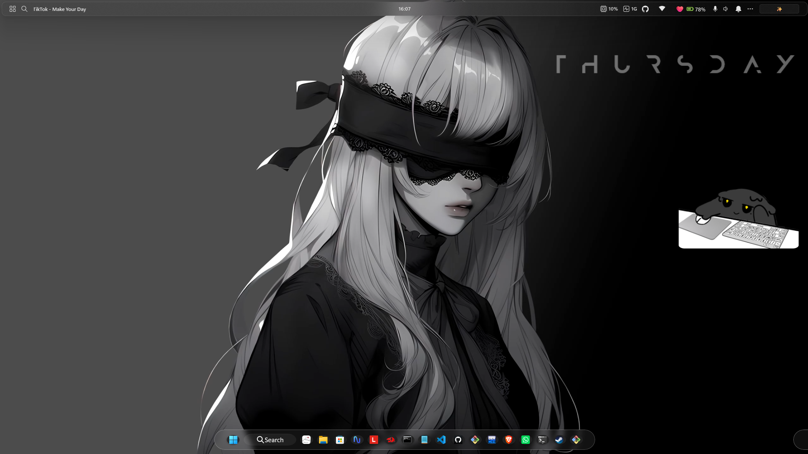

## Customize-Windows-11
For windows 11

 Use app Yasb and Windhawk and Bangocat

##  System Requirements

| Requirements | recommendations |
|:---:|---|
| OS | 64-bit Windows 10 |
| MEMORY | 8 GB RAM |
| STORAGE | 200 MB | 
-

## display

## --- YASB ----
https://github.com/amnweb/yasb

## --- Windhawk ---
https://github.com/ramensoftware/windhawk

## --- BongoCat ---
https://github.com/ayangweb/bongocat
